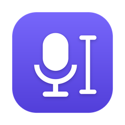

<div align="center">



# زمزمه (Zemzeme)

**شورتکات بزن، حرف بزن، و متن همان جایی که کرسر هست نوشته می‌شود.**

[](https://github.com/mhrezaei/Zemzeme/actions/workflows/ci.yml)
[](https://github.com/mhrezaei/Zemzeme/releases/latest)
[](LICENSE)

[English](README.md) · فارسی

</div>

<div dir="rtl">

زمزمه یک برنامه‌ی کوچک دیکته برای دسکتاپ است. صدای میکروفون را ضبط می‌کند، از طریق [OpenRouter](https://openrouter.ai) به یک مدل تبدیل گفتار به متن می‌فرستد، و متن را در هر برنامه‌ای که در آن تایپ می‌کنی paste می‌کند: ادیتور، مرورگر، چت یا ترمینال.

برای فارسی ساخته شده، که پر از کلمه‌های انگلیسی است، ولی با هر زبانی که مدل پشتیبانی کند کار می‌کند.

## امکانات

- **در هر برنامه‌ای کار می‌کند.** متن جای کرسر paste می‌شود و کلیپ‌بورد قبلی‌ات بعدش برمی‌گردد.
- **یک شورتکات.** `Super+Alt+Space` ضبط را شروع می‌کند و همان کلیدها تمامش می‌کنند. یک پنجره‌ی کوچک پایین صفحه سطح صدا، زمان و دکمه‌های توقف و لغو را نشان می‌دهد.
- **اصطلاحات انگلیسی با حروف انگلیسی (اختیاری).** یک مدل زبانی سریع جمله‌ی «کامیت کردم روی داکر» را به «commit کردم روی Docker» تبدیل می‌کند و به بقیه‌ی متن دست نمی‌زند.
- **واژه‌نامه‌ی شخصی.** اسم‌ها و اصطلاح‌های خودت را اضافه کن تا همان‌طور که می‌خواهی نوشته شوند.
- **انتخاب مدل.** پیش‌فرض `openai/gpt-4o-transcribe` است. هر مدل تبدیل گفتار به متنِ OpenRouter را می‌توانی انتخاب کنی.
- **حریم خصوصی:**
  - صدا فقط در حافظه می‌ماند و روی دیسک ذخیره نمی‌شود.
  - کلید API در Keyring سیستم نگه داشته می‌شود.
  - فایل لاگ هیچ‌وقت متن حرف‌هایت را ندارد.
- **سکوت و نویز را نادیده می‌گیرد.** صدای بدون گفتار فرستاده نمی‌شود، پس مدل از نویز محیط متن نمی‌سازد.
- **سبک و سریع.** با Rust و Tauri ساخته شده: حدود ۱۲ مگابایت، و در tray منتظر می‌ماند.

## پیش‌نیازها

- لینوکس با GNOME. روی Ubuntu 26.04 با Wayland تست شده. محیط‌های دیگر هم کار می‌کنند، ولی شورتکات را باید خودت اضافه کنی ([محیط‌های دیگر](#محیطهای-دیگر)).
- PipeWire، که سیستم صدای پیش‌فرض اوبونتوهای جدید است.
- یک [کلید API از OpenRouter](https://openrouter.ai/keys) با کمی اعتبار. هر پیام معمولاً **۰.۰۰۰۵ تا ۰.۰۰۱ دلار** خرج دارد.

مک و ویندوز هنوز پشتیبانی نمی‌شوند. بیشتر کد چندسکویی است و از مشارکت استقبال می‌شود.

## نصب

فایل `.deb` را از [آخرین نسخه](https://github.com/mhrezaei/Zemzeme/releases/latest) دانلود و نصب کن:

```bash
sudo apt install ./Zemzeme_*_amd64.deb
```

بعد **Zemzeme** را از منوی برنامه‌ها باز کن. بار اول:

- شورتکات `Super+Alt+Space` را اضافه می‌کند،
- خودش را در اجرای خودکار هنگام ورود قرار می‌دهد،
- یک آیکون در tray می‌گذارد.

روی آیکون کلیک کن، کلید OpenRouter را وارد کن، و تمام.

> بسته یک قانون udev هم نصب می‌کند که به برنامه اجازه می‌دهد کلیدهای paste را با یک کیبورد مجازی (`/dev/uinput`) بزند. اگر بلافاصله بعد از نصب paste کار نکرد، یک بار log out و دوباره log in کن.

## استفاده

۱. جایی که می‌خواهی بنویسی کلیک کن.
۲. `Super+Alt+Space` را بزن و حرف بزن.
۳. دوباره `Super+Alt+Space` را بزن. چند ثانیه بعد متن نوشته می‌شود.

دکمه‌ی **✕** در پنجره‌ی کوچک ضبط را لغو می‌کند. اگر برنامه نتواند paste کند (مثلاً اجازه‌ی کیبورد مجازی را نداشته باشد)، متن در کلیپ‌بورد می‌ماند و پیام *Copied — press Ctrl+V* نشان داده می‌شود.

### تنظیمات

| بخش | چه چیزهایی |
|---|---|
| کلید API | ذخیره، تست (مصرف OpenRouter را نشان می‌دهد)، حذف |
| تبدیل گفتار | مدل و زبان (خالی = تشخیص خودکار) |
| پاک‌سازی متن | روشن/خاموش کردن نوشتن اصطلاحات انگلیسی با حروف انگلیسی، مدل، واژه‌نامه |
| میکروفون | انتخاب ورودی، با تست زنده‌ی سطح صدا |
| Paste | `Ctrl+V`، `Ctrl+Shift+V` (بعضی ترمینال‌ها)، یا `Shift+Insert` |
| شورتکات | انتخاب یا ضبط کلیدها، اجرا هنگام ورود |
| پیشرفته | صدای شروع و پایان، نگه داشتن فایل‌های ضبط برای عیب‌یابی |

### خط فرمان

برنامه‌ی در حال اجرا دستور هم می‌گیرد، که برای محیط‌های دیگر یا اسکریپت‌ها به درد می‌خورد:

</div>

```bash
zemzeme toggle     # شروع / پایان ضبط
zemzeme cancel     # لغو ضبط
zemzeme settings   # باز کردن تنظیمات
zemzeme mics       # لیست میکروفون‌ها
zemzeme quit
```

<div dir="rtl">

### محیط‌های دیگر

در KDE، Sway، Hyprland و بقیه، در تنظیمات کیبورد یک کلید به دستور `zemzeme toggle` بده.

## حریم خصوصی

- صدا در حافظه ضبط و با HTTPS به OpenRouter فرستاده می‌شود. وقتی متن برگشت، پاک می‌شود. در *Advanced → Keep recordings* می‌توانی برای عیب‌یابی نگهش داری.
- OpenRouter صدا را به ارائه‌دهنده‌ی مدل (مثلاً OpenAI) می‌فرستد. سیاست‌های داده‌ی آن‌ها اعمال می‌شود. ببین: [تنظیمات حریم خصوصی OpenRouter](https://openrouter.ai/settings/privacy).
- کلید API در Keyring سیستم (GNOME Keyring) نگه داشته می‌شود، نه در فایل.
- لاگ (`~/.local/state/zemzeme/zemzeme.log`) فقط زمان‌ها و خطاها را دارد و هیچ‌وقت متن گفتار را ندارد.

## فایل‌ها

| چه | کجا |
|---|---|
| تنظیمات | `~/.config/zemzeme/settings.json` |
| کلید API | Keyring سیستم، سرویس `zemzeme` |
| لاگ | `~/.local/state/zemzeme/zemzeme.log` |

## رفع مشکل

- **چیزی paste نمی‌شود.** بعد از نصب یک بار log out و log in کن. اگر از سورس ساخته‌ای، یک بار `sudo ./scripts/setup-linux.sh` را اجرا کن.
- **پیام «Microphone is silent».** در تنظیمات میکروفون دیگری انتخاب کن و با **Test** امتحان کن. میکروفون هدست‌های بلوتوثی در لینوکس اغلب کار نمی‌کند: پروفایل HFP لازم دارد که بعضی دانگل‌ها پشتیبانی نمی‌کنند.
- **در ترمینال متن نمی‌آید.** *Paste* را روی `Ctrl+Shift+V` بگذار.
- **شورتکات کاری نمی‌کند.** در تنظیمات GNOME بخش *Keyboard → Custom Shortcuts* را ببین. اسم آیتم *Zemzeme* است.

## ساخت از سورس

Rust (نسخه‌ی stable)، Node.js نسخه‌ی ۲۲ یا بالاتر، و پکیج‌های سیستمی Tauri لازم است:

</div>

```bash
sudo apt install build-essential libwebkit2gtk-4.1-dev libayatana-appindicator3-dev \
  librsvg2-dev libasound2-dev libdbus-1-dev libssl-dev
```

```bash
git clone https://github.com/mhrezaei/Zemzeme.git && cd Zemzeme
npm install
sudo ./scripts/setup-linux.sh   # once: allow the virtual keyboard
./scripts/install-linux.sh      # build and install to ~/.local/bin (no sudo)
```

<div dir="rtl">

حذف: `./scripts/install-linux.sh --uninstall`. برای ساخت بسته‌ی `.deb`: `npm run tauri build`.

### توسعه

- اجرا: `npm run tauri dev`
- در حالت توسعه، تنظیمات بار اول از `.env` خوانده می‌شود (نمونه: [.env.example](.env.example)).
- تست‌ها: `cargo test` در پوشه‌ی `src-tauri`.
- ابزارهای تست در `src-tauri/examples` هستند: `record`، `transcribe` و `chime`.
- معماری و جزئیات فنی در [README انگلیسی](README.md#how-it-works) آمده است.

## برنامه‌های آینده

- حالت ترجمه (فارسی بگو، انگلیسی بنویسد)
- توقف خودکار بعد از سکوت
- تاریخچه‌ی متن‌های اخیر
- مک و ویندوز

## مجوز

[MIT](LICENSE)

</div>
